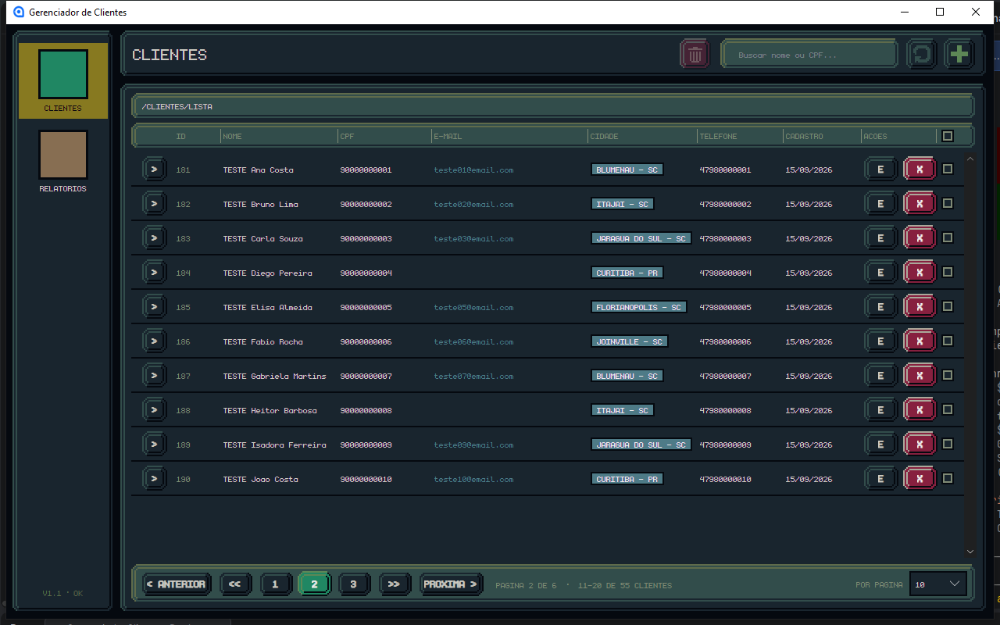

# Gestor de Recursos

Sistema para gestão de recursos de trânsito: cadastro de clientes, acompanhamento dos recursos protocolados e controle financeiro (quem contratou o quê, o que foi pago e o que está em aberto).

Escrito em **C# / .NET 10** com banco **Oracle**, em duas interfaces que compartilham o mesmo código de acesso a dados: uma aplicação de console e uma aplicação desktop em **Avalonia**.

> **Em construção.** O projeto parte do [Gerenciador de Clientes](https://github.com/GustavoFranca7/GerenciadorClientes), que já traz o cadastro de clientes e endereços funcionando. O modelo dos recursos, o controle financeiro e o visual definitivo ainda estão sendo feitos, então as telas atuais ainda são as herdadas daquele projeto.

## O que já funciona (herdado)

- **Cadastro** de cliente e endereço gravados juntos, numa única transação
- **Listagem paginada**, com escolha de 10 a 100 registros por página
- **Edição** no mesmo formulário do cadastro, já preenchido com os dados atuais
- **Exclusão** de um registro, ou de vários de uma vez pelas caixinhas de seleção, sempre com confirmação
- **Validação** de CPF, telefone, UF e CEP, com correção automática do que a pessoa digita



## O que vem pela frente

- Modelo de dados dos **recursos**: infração, órgão, prazos, fase e situação
- **Financeiro**: valor combinado, forma de pagamento, parcelas, o que foi pago e o que está em aberto
- **Relatórios**: recebimentos do mês, clientes em atraso e recursos por situação
- **Busca** por nome e CPF
- **Visual formal**, no lugar da interface em pixel art herdada

## Tecnologias

| Camada | O que é usado |
|---|---|
| Linguagem | C# 14 / .NET 10 |
| Banco | Oracle, via `Oracle.ManagedDataAccess.Core` |
| Interface desktop | Avalonia 12 com MVVM (`CommunityToolkit.Mvvm`) |
| Configuração | `Microsoft.Extensions.Configuration` (arquivo, User Secrets e variáveis de ambiente) |

## Estrutura

```
GestorRecursos.Core/         Regras e acesso ao banco (não conhece nenhuma tela)
├── Data/                    Database (conexão) e os DAOs
├── Models/                  Entidades
└── Validacao/               Normalização de CPF, telefone, UF e CEP

GestorRecursos.Api/          API REST em ASP.NET Core

GestorRecursos.Desktop/      Interface gráfica em Avalonia (MVVM)
├── Assets/Icones.axaml      Os desenhos dos ícones, por nome
├── Styles/
│   ├── Cores.axaml          A paleta: toda cor do sistema sai daqui
│   └── Componentes.axaml    O que mais de uma tela usa (dado copiável, busca, selo)
├── Servicos/                Área de transferência e máscaras de digitação
├── Views/                   As telas, em XAML
│   ├── Janela/              A moldura: menu lateral e barra de cima
│   ├── Clientes/            Listagem, ficha e o cadastro
│   └── Arquivados/          O arquivo
└── ViewModels/              O que cada tela sabe e faz, nas mesmas pastas das Views
    └── Comum/               Base, formatação, prazos e conversores

Database/                    Scripts numerados, na ordem em que se roda
├── 01-CriacaoBanco.sql      Tabelas, índices e constraints
├── 02-CargaInicial.sql      Dados que o sistema precisa para funcionar
├── 03-DadosEscritorio.sql   Dados reais do escritório (fora do Git)
├── 04-DadosTeste.sql        30 clientes de teste
└── 99-LimpezaDesenvolvimento.sql
```

**Views e ViewModels andam em par.** `Views/Clientes/FichaClienteView.axaml` é a tela de
`ViewModels/Clientes/FichaClienteViewModel.cs`: mesmo nome, mesma pasta. É assim que o
`ViewLocator` liga as duas, trocando "ViewModel" por "View" no nome do tipo. As pastas são
arrumação — o namespace continua sendo um por camada.

A dependência aponta em um sentido só: as interfaces usam a `Core`, e a `Core` não conhece
nenhuma delas.

## Como rodar

### 1. Pré-requisitos

- [.NET SDK 10](https://dotnet.microsoft.com/download)
- Um banco Oracle acessível. O projeto foi desenvolvido com o **Oracle Database XE** instalado na própria máquina, que é gratuito.

### 2. Criar as tabelas

Conecte no banco com o seu usuário (SQL Developer, SQLcl, SQL*Plus ou o de sua preferência) e execute os scripts da pasta `Database/` na ordem do número:

```
01-CriacaoBanco.sql
02-CargaInicial.sql
```

Para povoar com clientes de teste, rode também o `04-DadosTeste.sql`.

### 3. Informar a conexão com o banco

Nenhuma senha fica no código. A aplicação procura a connection string `Oracle` em três lugares, nesta ordem (o seguinte sobrescreve o anterior):

1. `appsettings.json`, na pasta do executável
2. **User Secrets** do .NET (recomendado: fica fora da pasta do projeto, longe do Git)
3. Variáveis de ambiente

A forma mais simples, na pasta do projeto `GestorRecursos.Core`:

```bash
dotnet user-secrets set "ConnectionStrings:Oracle" "User Id=SEU_USUARIO;Password=SUA_SENHA;Data Source=localhost:1521/XEPDB1;"
```

Prefere arquivo? Crie um `appsettings.json` na pasta do executável com a seção `ConnectionStrings`. Esse nome está no `.gitignore` e não vai para o repositório.

Pelas variáveis de ambiente, o nome é `ConnectionStrings__Oracle` (dois sublinhados).

### 4. Executar

Interface gráfica:

```bash
dotnet run --project GestorRecursos.Desktop
```

### 5. Se a tela piscar ou rasgar

Em placas NVIDIA, a composição padrão do Windows faz a janela aparecer semitransparente por
um quadro de vez em quando ([Avalonia #13620](https://github.com/AvaloniaUI/Avalonia/issues/13620)).
Por isso o aplicativo pede `RedirectionSurface`, que não passa por esse caminho. Para
comparar os modos sem recompilar:

```bash
GESTOR_COMPOSICAO=winui dotnet run --project GestorRecursos.Desktop
```

Valores aceitos: `redirection` (padrão), `winui` e `directcomposition`.

## Detalhes da implementação

- **Transações:** os registros relacionados são gravados (e excluídos) juntos. Se qualquer passo falhar, um `Rollback` desfaz tudo e o banco não fica pela metade.
- **Paginação no banco:** a consulta usa `OFFSET ... FETCH NEXT` e traz os dados relacionados na mesma ida ao banco, com `LEFT JOIN` e `ROW_NUMBER`.
- **Consultas parametrizadas:** todos os valores vão por parâmetros (`:nome`, `:cpf`...), nunca concatenados no SQL.
- **MVVM:** as telas não sabem conversar com o banco; elas apenas exibem o que está nos ViewModels e disparam comandos.

## Autor

Gustavo França — [github.com/GustavoFranca7](https://github.com/GustavoFranca7)
