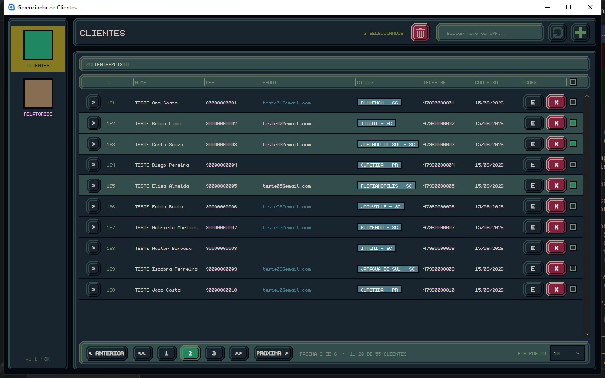
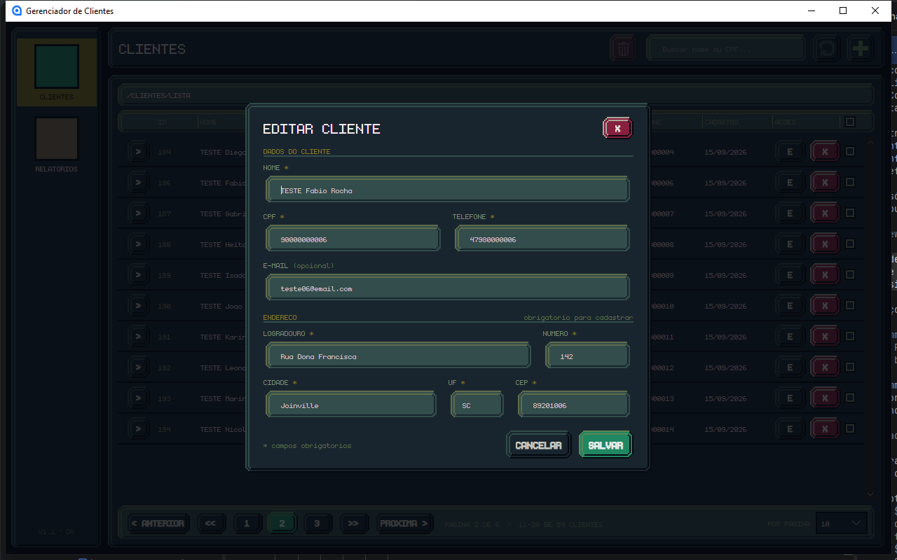
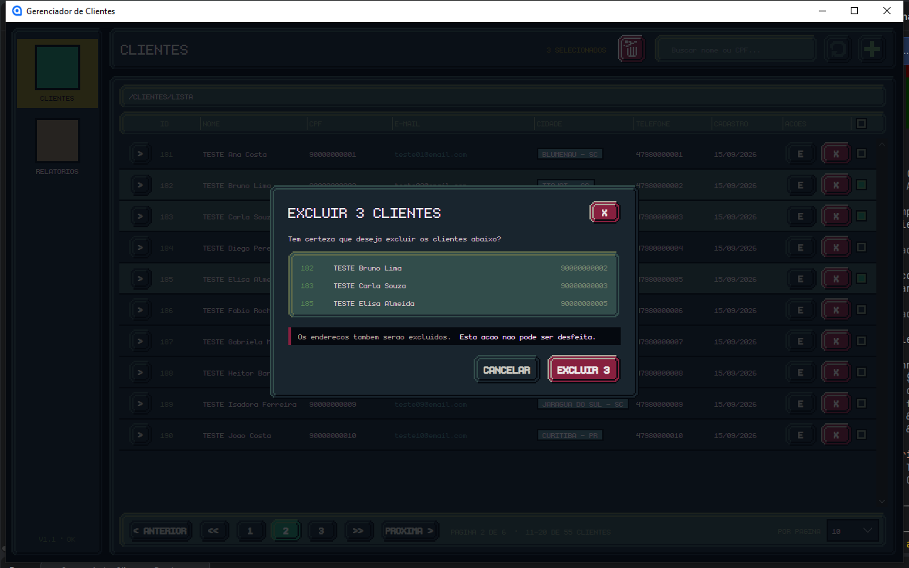

# Gerenciador de Clientes

CRUD completo de clientes e endereços em **C# / .NET 10** com banco **Oracle**, em duas interfaces que compartilham o mesmo código de acesso a dados: uma aplicação de console e uma aplicação desktop em **Avalonia**, com visual em pixel art.


## O que o sistema faz

- **Cadastro** de cliente e endereço gravados juntos, numa única transação
- **Listagem paginada**, com escolha de 10 a 100 clientes por página
- **Endereço expansível** em cada linha, pela setinha
- **Edição** no mesmo formulário do cadastro, já preenchido com os dados atuais
- **Exclusão** de um cliente pelo botão X, ou de vários de uma vez pelas caixinhas de seleção
- **Confirmação antes de excluir**, mostrando quem será apagado
- **Validação** de CPF, telefone, UF e CEP, com correção automática do que a pessoa digita
- **Colunas ajustáveis** arrastando as barrinhas do cabeçalho, e textos que podem ser copiados

| Seleção para excluir | Formulário | Confirmação |
|---|---|---|
|  |  |  |

## Tecnologias

| Camada | O que é usado |
|---|---|
| Linguagem | C# 14 / .NET 10 |
| Banco | Oracle, via `Oracle.ManagedDataAccess.Core` |
| Interface desktop | Avalonia 12 com MVVM (`CommunityToolkit.Mvvm`) |
| Configuração | `Microsoft.Extensions.Configuration` (arquivo, User Secrets e variáveis de ambiente) |

## Estrutura

```
GestorRecursos.Core/         Regras e acesso ao banco (não conhece nenhuma tela)
├── Data/                         Database (conexão) e os DAOs de cliente e endereço
├── Models/                       Cliente e Endereco
└── Validacao/                    Normalização de CPF, telefone, UF e CEP

GestorRecursos.ConsoleApp/   Interface de linha de comando
GestorRecursos.Desktop/      Interface gráfica em Avalonia (MVVM)
├── Assets/                       Arte em pixel art, ícones e fonte
├── Controls/                     Controles próprios (moldura fatiada, notificação, etc.)
├── Styles/                       Paleta de cores e aparência dos botões
├── ViewModels/                   Estado e comandos das telas
└── Views/                        Telas em XAML

Database/CriacaoTabelas.sql       Script de criação das tabelas
```

A dependência aponta em um sentido só: as duas interfaces usam a `Core`, e a `Core` não conhece nenhuma delas.

## Como rodar

### 1. Pré-requisitos

- [.NET SDK 10](https://dotnet.microsoft.com/download)
- Um banco Oracle acessível. O projeto foi desenvolvido com o **Oracle Database XE** instalado na própria máquina, que é gratuito.

### 2. Criar as tabelas

Conecte no banco com o seu usuário (SQL Developer, SQLcl, SQL*Plus ou o de sua preferência) e execute o script:

```
Database/CriacaoTabelas.sql
```

Ele cria as tabelas `CLIENTES` e `ENDERECOS`, as sequences dos IDs e um índice na chave estrangeira.

### 3. Informar a conexão com o banco

Nenhuma senha fica no código. A aplicação procura a connection string `Oracle` em três lugares, nesta ordem (o seguinte sobrescreve o anterior):

1. `appsettings.json`, na pasta do executável (hoje só o projeto de console copia esse arquivo para lá)
2. **User Secrets** do .NET (recomendado: fica fora da pasta do projeto, longe do Git)
3. Variáveis de ambiente

A forma mais simples, na pasta do projeto `GestorRecursos.Core`:

```bash
dotnet user-secrets set "ConnectionStrings:Oracle" "User Id=SEU_USUARIO;Password=SUA_SENHA;Data Source=localhost:1521/XEPDB1;"
```

Prefere arquivo? Copie `GestorRecursos.ConsoleApp/appsettings.example.json` para `appsettings.json`, na mesma pasta, e preencha os valores. Esse nome está no `.gitignore` e não vai para o repositório. Isso vale para o console; a interface gráfica lê o User Secrets ou as variáveis de ambiente.

Pelas variáveis de ambiente, o nome é `ConnectionStrings__Oracle` (dois sublinhados).

Se nada estiver configurado, a aplicação avisa na hora de acessar o banco, dizendo exatamente qual comando executar.

### 4. Executar

Interface gráfica:

```bash
dotnet run --project GestorRecursos.Desktop
```

Interface de console:

```bash
dotnet run --project GestorRecursos.ConsoleApp
```

## Detalhes da implementação

- **Transações:** cliente e endereço são gravados (e excluídos) juntos. Se qualquer passo falhar, um `Rollback` desfaz tudo e o banco não fica pela metade. A exclusão em grupo segue a mesma regra: ou todos saem, ou nenhum.
- **Paginação no banco:** a consulta usa `OFFSET ... FETCH NEXT` e traz o endereço de cada cliente na mesma ida ao banco, com `LEFT JOIN` e `ROW_NUMBER`.
- **Consultas parametrizadas:** todos os valores vão por parâmetros (`:nome`, `:cpf`...), nunca concatenados no SQL.
- **MVVM:** as telas não sabem conversar com o banco; elas apenas exibem o que está nos ViewModels e disparam comandos.
- **Pixel art:** as artes de 96x24 px são cortadas em 9 fatias, o que permite botões e molduras de qualquer tamanho sem deformar os cantos. A arte e os ícones foram desenhados no Aseprite.

## Próximos passos

- Busca por nome e CPF
- Tela de relatórios
- Alternância entre tema claro e escuro

## Autor

Gustavo França — [github.com/GustavoFranca7](https://github.com/GustavoFranca7)
