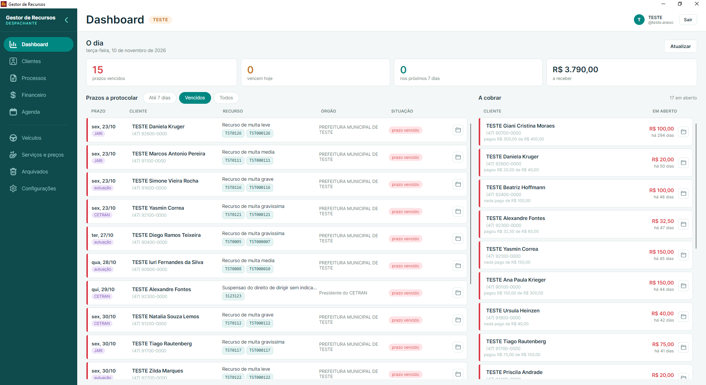

# Gestor de Recursos

Sistema de gestão para um escritório de **recursos de trânsito**: os clientes, os serviços
que cada um contratou, o andamento de cada recurso com seus prazos e o controle financeiro
— quem contratou o quê, o que foi pago e o que está em aberto.

Não é um exercício de portfólio. O sistema está **instalado no escritório e em uso diário
desde novembro de 2026**, com dados reais, e substituiu a planilha que fazia esse controle.
A versão em produção é a `1.2.0`.

Escrito em **C# / .NET 10**, com **Oracle Autonomous Database** na nuvem e interface
desktop em **Avalonia** (MVVM). Nasceu de um clone do
[Gerenciador de Clientes](https://github.com/GustavoFranca7/GerenciadorClientes), de onde
veio o primeiro CRUD; as tabelas foram remodeladas e a interface herdada saiu do código em
outubro de 2026.



<sub>A imagem é do banco de teste — por isso o selo TESTE e os nomes iniciados por
"TESTE". Dados reais de clientes não aparecem aqui nem em lugar algum deste repositório.</sub>

## O que o sistema faz

**Clientes.** Cadastro de cliente e endereço gravados juntos, numa transação só. O CEP
preenche bairro, cidade e UF pela consulta online. CPF, telefone, UF e CEP são normalizados
na digitação. Busca por nome e por CPF, ficha completa com histórico, e um arquivo para
quem deixou de ser cliente sem perder o que já aconteceu.

**Serviços e prazos.** Cada serviço contratado segue um fluxo com etapas, e cada etapa tem
prazo contado a partir do que aconteceu antes — defesa prévia, recurso à JARI, recurso ao
CETRAN, processo de CNH. O andamento registra o resultado de cada fase (incluindo
"anulado", que reabre a seguinte) e recalcula o que vence depois.

**Financeiro.** Valor combinado por item contratado, pagamentos lançados parcela a parcela
e o saldo em aberto calculado no banco, não na tela.

**Visão do dia.** A tela de abertura reúne o que vence nos próximos dias e as cobranças em
aberto — a pergunta que a planilha não respondia sem alguém somar à mão.

**Documentos.** A ficha guarda os arquivos do cliente (procuração assinada, CNH, CRLV,
comprovantes), com download e abertura direta. A procuração é gerada em PDF pelo próprio
sistema. E os cadastros antigos entraram por importação: o sistema **lê as procurações já
emitidas em Word e PDF** e preenche a ficha a partir delas.

**Acesso.** Login por usuário e senha, com recuperação por código enviado ao e-mail,
administração de contas e redefinição de senha.

**Cópia de segurança.** Um executável próprio exporta o esquema inteiro e espelha os
documentos, agendado para rodar toda semana. Cada execução fica registrada no banco, e o
sistema **avisa na tela quando a cópia para de acontecer**.

## Decisões que valem explicar

**Senha que o sistema não sabe qual é.** PBKDF2 com SHA-256 do próprio .NET, sal sorteado
por senha e 210.000 iterações. As iterações ficam gravadas junto do hash, então o custo
pode subir depois sem invalidar o que já está no banco. O código de recuperação passa pelo
mesmo caminho, pelo mesmo motivo: quem conseguir ler a tabela não entra com o que leu.

**O programa não é o dono do banco.** Em produção a aplicação conecta com um usuário
próprio, que não é o dono do esquema: ele alcança as tabelas por `GRANT` nominal e
`CURRENT_SCHEMA`, e **não tem permissão de DDL**. Uma consequência concreta disso está
documentada em `Database/08-UsuarioDaEstacao.sql`: tabela nova nasce invisível para a
aplicação e devolve `ORA-00942` com a tabela já criada, então todo script que cria tabela
termina com o `GRANT`.

**Nenhuma credencial no código.** A connection string vem do `appsettings.json`, dos User
Secrets ou de variáveis de ambiente, nessa ordem. A conexão com o Autonomous Database usa
**wallet e mTLS**, e nem a wallet nem o arquivo de configuração real entram no repositório.

**Backup pensado pela restauração.** A exportação sai em SQL na ordem das chaves
estrangeiras, para poder voltar de uma vez — e a restauração foi testada ponta a ponta num
banco vazio, não apenas o despejo. O plano gratuito usado não tem *point-in-time restore*,
então a cópia é a única rede: daí o registro de cada execução no banco e o aviso quando ela
silencia.

**Importar errado é pior que não importar.** A procuração qualifica duas pessoas no mesmo
formato — o cliente e a despachante que assina. O leitor corta o texto em "OUTORGADO:" e lê
só a primeira metade; depois confronta o resultado com os dados do escritório e **recusa o
documento** se um identificador da despachante escapou para o lado do cliente, em vez de
gravar um cadastro trocado.

**Transações e consultas parametrizadas, sempre.** Gravação que toca mais de uma tabela vai
em transação com `Rollback`; todo valor viaja por parâmetro (`:nome`, `:cpf`), nunca
concatenado no SQL. A paginação é feita no banco, com `OFFSET ... FETCH NEXT`, trazendo os
dados relacionados na mesma ida.

**A camada de dados não conhece tela nenhuma.** `GestorRecursos.Core` é consumida pelo
desktop, pela API e pelo executável de backup. A dependência aponta em um sentido só, e não
existe SQL fora de `Core/Data`.

**Entregue como programa, não como pasta.** Um instalador feito no Inno Setup gera um `.exe`
único: instala no perfil do usuário (sem pedir senha de administrador), cria os atalhos,
aparece em "Adicionar ou remover programas" e **atualiza no lugar**, mesmo com o programa
aberto. A tela de Configurações mostra a versão instalada e as notas de cada atualização,
escritas para quem usa o sistema.

## Tecnologias

| Camada | O que é usado |
|---|---|
| Linguagem | C# 14 / .NET 10 |
| Banco | Oracle Autonomous Database (OCI), via `Oracle.ManagedDataAccess.Core` |
| Interface desktop | Avalonia 12 com MVVM (`CommunityToolkit.Mvvm`) |
| API | ASP.NET Core |
| PDF | QuestPDF |
| Configuração | `Microsoft.Extensions.Configuration` (arquivo, User Secrets e variáveis de ambiente) |
| Instalador | Inno Setup |
| Agendamento | Agendador de Tarefas do Windows |

## Estrutura

```
GestorRecursos.Core/         Regras e acesso ao banco (não conhece nenhuma tela)
├── Data/                    Conexão async, os DAOs e as extensões de leitura
├── Models/                  Entidades e os enums dos domínios fechados
├── Documentos/              Geração de PDF (procuração)
├── Importacao/              Leitura das procurações antigas (.docx e .pdf)
├── Exportacao/              Gravação dos documentos em disco
├── Integracoes/             Consulta de CEP e envio de e-mail
├── Seguranca/               Hash de senha (PBKDF2)
└── Validacao/               Normalização de CPF, telefone, UF e CEP

GestorRecursos.Desktop/      Interface gráfica (Avalonia 12 + MVVM)
├── Assets/Icones.axaml      Os desenhos dos ícones, por nome
├── Styles/
│   ├── Cores.axaml          A paleta: toda cor do sistema sai daqui
│   └── Componentes.axaml    O que mais de uma tela usa
├── Servicos/                Notificações, área de transferência e máscaras
├── Views/                   As telas em XAML, por área
│   ├── Janela/              A moldura: login, menu lateral e barra de cima
│   ├── Dashboard/           A visão do dia
│   ├── Clientes/            Lista, ficha, cadastro, contratação e documentos
│   ├── Servicos/            Os serviços oferecidos
│   ├── Configuracoes/       Escritório, usuários, versão e cópia de segurança
│   └── Arquivados/          O arquivo
└── ViewModels/              Estado e comandos, nas mesmas pastas das Views

GestorRecursos.Api/          API REST em ASP.NET Core (consome a Core direto)
GestorRecursos.Backup/       Executável da cópia de segurança, para o agendador
Instalador/                  Script do Inno Setup e empacotamento
Database/                    Scripts numerados, na ordem em que se roda
Scripts/                     Publicação do backup e utilitários de desenvolvimento
```

**Views e ViewModels andam em par.** `Views/Clientes/FichaClienteView.axaml` é a tela de
`ViewModels/Clientes/FichaClienteViewModel.cs`: mesmo nome, mesma pasta. É assim que o
`ViewLocator` liga as duas, trocando "ViewModel" por "View" no nome do tipo. As pastas são
arrumação — o namespace continua sendo um por camada.

## Como rodar

### 1. Pré-requisitos

- [.NET SDK 10](https://dotnet.microsoft.com/download)
- Um banco Oracle acessível. O desenvolvimento começou no **Oracle Database XE** local, que
  é gratuito, e hoje usa o **Autonomous Database** da OCI.

### 2. Criar as tabelas

Conecte no banco (SQL Developer, SQLcl, SQL\*Plus) e rode os scripts de `Database/` na ordem
do número — `01` a `12` montam o esquema. Para povoar com clientes de teste, rode também o
`04-DadosTeste.sql`.

### 3. Informar a conexão

Nenhuma senha fica no código. A aplicação procura a connection string `Oracle` em três
lugares, nesta ordem (o seguinte sobrescreve o anterior):

1. `appsettings.json`, na pasta do executável
2. **User Secrets** do .NET (recomendado: fica fora da pasta do projeto, longe do Git)
3. Variáveis de ambiente

A forma mais simples, na pasta de `GestorRecursos.Core`:

```bash
dotnet user-secrets set "ConnectionStrings:Oracle" "User Id=SEU_USUARIO;Password=SUA_SENHA;Data Source=localhost:1521/XEPDB1;"
```

Pelas variáveis de ambiente, o nome é `ConnectionStrings__Oracle` (dois sublinhados). Para
conectar no Autonomous Database, veja `Database/ConfiguracaoNuvem.md`.

### 4. Executar

```bash
dotnet build GestorRecursos.slnx
dotnet run --project GestorRecursos.Desktop
```

### 5. Se a tela piscar ou rasgar

Em placas NVIDIA, a composição padrão do Windows faz a janela aparecer semitransparente por
um quadro de vez em quando ([Avalonia #13620](https://github.com/AvaloniaUI/Avalonia/issues/13620)).
Por isso o aplicativo pede `RedirectionSurface`, que não passa por esse caminho. Para
comparar os modos sem recompilar:

```bash
GESTOR_COMPOSICAO=winui dotnet run --project GestorRecursos.Desktop
```

Valores aceitos: `redirection` (padrão), `winui` e `directcomposition`.

## Banco de dados

| Script | O que faz |
|---|---|
| `01-CriacaoBanco.sql` | Tabelas, índices e constraints |
| `02-CargaInicial.sql` | Dados que o sistema precisa para funcionar |
| `03-DadosEscritorio.sql` | Dados do escritório que assina os documentos — **fora do Git**, há um `.exemplo` |
| `04-DadosTeste.sql` | Clientes de teste |
| `05` a `12` | Fluxo dos serviços, prazos, login, usuário da aplicação, anexos e registro do backup |
| `90-EspacoNoBanco.sql` | Quanto espaço o banco usa e qual tabela cresceu |
| `99-LimpezaDesenvolvimento.sql` | Devolve o banco ao estado inicial |

O que sai do sistema — o instalador gerado, o arquivo de backup e os documentos exportados —
carrega senha de banco, wallet e dados reais de clientes. Nada disso vai para o repositório:
o `.gitignore` cobre esses caminhos.

## O que vem pela frente

- Completar a aba de serviços e os relatórios de recebimento
- Aba de armazenamento nas configurações, mostrando o quanto do plano gratuito já foi usado
- Expandir a API REST, hoje com o primeiro recurso publicado

## Autor

Gustavo França — [github.com/GustavoFranca7](https://github.com/GustavoFranca7)
